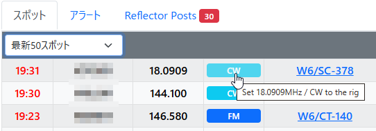

# SOTAWatch Connect

**SOTAWatch Connect** is a browser extension and desktop bridge that turns mode badges on the SPOTS list of [SOTAwatch3](https://sotawatch.sota.org.uk/) and [POTA](https://pota.app/) into **interactive buttons**. It allows you to tune your rig to a spotted frequency and mode with a single click.

## Features

- **Interactive Mode Buttons**: Turns SOTAwatch3 and POTA mode/frequency badges into clickable buttons for instant rig control.

  

- **Multiple Rigs**: Configure any number of rigs in a single CSV file, then pick the "active rig" from the extension's popup. One click sends the spot to whichever rig is currently selected.
- **Smart Band/Mode Logic**:
  - Automatically converts **SSB** spots to **LSB** for frequencies below 10MHz and **USB** for 10MHz and above.
  - POTA's `FT4`/`FT8` and SOTAwatch3's `DATA` are both mapped to the rig's digital mode.
- **Clean UI**: Minimalist design that preserves the original site appearance while adding hover and click feedback.

## Prerequisites

This tool requires **Python** and **Hamlib (rigctld)** to be set up on your system.

### 1. Check Python Environment

Before running the bridge, verify that Python 3 is installed:

1.  Open **Bash or Command Prompt**.
2.  Run the following command:

```Bash
python --version
```

3.  If a version number is displayed, your environment is ready. If not, please install Python from [python.org](https://www.python.org/).

### 2. Install Hamlib

Hamlib is required to control your radio.

1. Download and install the latest version for your OS from the [Hamlib release page](https://github.com/Hamlib/Hamlib/releases).

### 3. Find your RigID (Hamlib)

To find the specific ID for each of your transceivers, use the following command in **Bash or Command Prompt**:

```Bash
rigctl -l
```

Example: The RigID for the Yaesu FT-817 is 1020.

## Installation

### 1. Browser Extension

As this is currently a private release, install it via Chrome/Edge **Developer Mode**:

1. Navigate to `chrome://extensions/`.
2. Enable "**Developer mode**" (top-right toggle).
3. Click "**Load unpacked**" and select the `extension` folder from this package.

### 2. Python Bridge

The bridge acts as a relay between the browser and Hamlib.

1. Install the required python libraries via **Bash or Command Prompt**:

```Bash
pip install flask flask-cors
```

**Note**: If it doesn't work, try:

```Bash
python -m pip install flask flask-cors
```

### 3. Configure Your Rig(s) — `bridge/rigs.csv`

Copy `bridge/rigs.sample.csv` to `bridge/rigs.csv`, then open `bridge/rigs.csv` in a text editor (Excel works too).

The sample contains example values only. Replace the entries with your own rig(s) and COM port(s) (you can check the COM port number in Windows Device Manager).

```csv
name,model,com_port,baud,rigctld_port
FT-817ND,1020,COM3,9600,4533
FTX-1,1051,COM7,38400,4534
```

| Column         | Meaning                                                                              |
| -------------- | ------------------------------------------------------------------------------------ |
| `name`         | Display name shown in the extension popup. Pick anything you like.                   |
| `model`        | Hamlib RigID (see "Find your RigID" above).                                          |
| `com_port`     | The COM port your rig is connected to.                                               |
| `baud`         | Baud rate for CAT communication.                                                     |
| `rigctld_port` | A unique TCP port for this rig's `rigctld` instance. Keep each rig's port different. |

- To use **one rig**, just write a single data row.
- To add more rigs, add more rows — each with its own `rigctld_port`.
- Your `rigs.csv` is not included in the release package, so updating the tool will not overwrite it.

## Auto-Start Setup (Windows)

You can use the included `start_rig_bridge.vbs` and `start_rig_bridge.bat` to automatically start `rigctld` (once per rig listed in `rigs.csv`) and the Python bridge `rig_bridge.py` in the background (without a black console window) when your PC starts.

### Setup Steps

1. **Configure Rigs**: Make sure `bridge/rigs.csv` lists all the rigs you want to control (see above).
2. **Add to Startup**:
   - Press `Windows Key + R`, type `shell:startup`, and click OK to open the Startup folder.
   - Create a **shortcut** of `start_rig_bridge.vbs` and move that shortcut into the Startup folder.
3. **Restart**: Sign out and sign back in (or restart) to start the programs automatically in the background.

**Note**: If `rigctld` is not in your system PATH, open `start_rig_bridge.vbs` in a text editor and set the full path in the `RIGCTLD_EXE` line near the top. If the path contains spaces (e.g., `C:\Program Files\...`), wrap it in extra double quotes as shown in the comment right above that line.

## Selecting the Active Rig (Extension Popup)

With multiple rigs configured, the extension needs to know which one a badge click should control.

1. Click the **SOTAWatch Connect icon** in your browser toolbar.
2. A popup opens and fetches the rig list from the bridge (`GET /rigs`), showing the names you set in `rigs.csv`.
3. Choose the rig you want to control right now. Your choice is remembered (via `chrome.storage.local`) until you change it again — you don't need to re-select it every time you open the browser.
4. Click a mode badge on SOTAwatch3/POTA as usual; it will be sent to whichever rig is currently selected.

If the popup shows "Cannot connect to bridge," the Python bridge (`rig_bridge.py`) isn't reachable — see **Troubleshooting** below. If a badge click shows an alert saying no rig is selected, open the popup and pick one first.

## Network & Security Configuration

### Bridge Port (Optional)

By default, the Python bridge uses port **5001** (separate from each rig's `rigctld_port` in `rigs.csv`). If this port is already in use by another application, you can change it:

1.  **In `rig_bridge.py`**: Update `BRIDGE_PORT = 5001` to your desired port number.
2.  **In `content.js`** and **`popup.js`**: Update `const BRIDGE_PORT = 5001` in both files to match the new port.
3.  **Reload the Extension**: Go to `chrome://extensions/` and click the **Update** or **Reload** icon for SOTAWatch Connect.

### Firewall Warning (Windows Users)

When you run this Python bridge for the first time, Windows Defender Firewall may display a popup asking:
"**Allow access to this app on private and public networks?**" or "**Allow Python to communicate on these networks?**"

- **Crucial**: Please click **"Allow Access"**. If you click "Cancel" or "Block," the browser extension will not be able to communicate with the bridge, and the tool will not work.
- **If you accidentally blocked it**:
  1. Open **Control Panel** > **System and Security** > **Windows Defender Firewall** > **Allow an app or feature through Windows Defender Firewall**.
  2. Find `python.exe` or `pythonw.exe` or `rigctld` and ensure both "Private" and "Public" checkboxes are checked.

### Coexistence with Other CAT Control Applications (e.g., WSJT-X)

SOTAWatch Connect runs its own dedicated `rigctld` instance for each rig, on the `rigctld_port` you set in `rigs.csv` (e.g., 4533, 4534, ...).

- **COM Port Conflict**: This tool will not function while other software, such as **WSJT-X** or **Turbo HAMLOG**, is directly controlling the rig via the same COM port. Only one application can access the same COM port at a time.
- **Coexistence Hint**: You can use WSJT-X with this tool simultaneously by configuring WSJT-X to connect via **"Hamlib NET rigctl"** instead of a rig name, pointed at **localhost:\<rigctld_port\>** for the rig you want. Set this once per rig, matching the `rigctld_port` in `rigs.csv`.
- **Switching rigs in WSJT-X**: WSJT-X's **File → Configurations** feature lets you save CAT settings _and_ the audio device together as one named configuration per rig, so switching rigs is a single menu click instead of re-entering settings each time. If your rigs share the same generic USB audio chipset, Windows can occasionally reassign device numbers between reboots; keeping each rig's USB cable plugged into the same physical port, and disabling Windows' "Fast Startup," both help keep device numbering stable.

## Troubleshooting

### Extension popup says "Cannot connect to bridge"

This means the browser reached the popup, but `rig_bridge.py` isn't listening on the bridge port. Since the bridge normally runs via `pythonw` (which hides all output, including errors), the fastest way to find the cause is:

1. Open a Command Prompt, `cd` into the `bridge` folder, and run `python rig_bridge.py` directly (not `pythonw`). Any startup error will now be printed to the console.
2. If it starts successfully, you'll see `RIG Bridge starting...` followed by a line listing the configured rigs.
3. If nothing is wrong here, double check that the copy of the tool you're running (and the shortcut in your Startup folder) points at the same install location you're editing — a stale second copy, or a shortcut still pointing at an older folder, will look identical in Task Manager but won't reflect your `rigs.csv` changes.
4. Also check Task Manager for a `pythonw.exe` process, that `bridge/rigs.csv` is where `rig_bridge.py` expects it, and the Firewall setting above.

## Compatibility & Feedback

- **Confirmed**: Successfully tested with **Yaesu FT-817ND**.
- **Others**: Should support most rigs compatible with Hamlib.
- **Feedback**: Feedback from users of other rigs is highly appreciated!

## Test Tool

A standalone `rigctld` connectivity test tool is included. Run it against any of your configured rigs by passing its `rigctld_port`:

```Bash
python rig_test.py 127.0.0.1 4533
```

(Omit the arguments to test the default `127.0.0.1:4533`.) If successful, it reads the rig's current frequency and mode, then briefly nudges the frequency by +100Hz and back.

## License

(c) 2026 Takeshi Mishima JK1VUZ. Released under the MIT License (see LICENSE).
